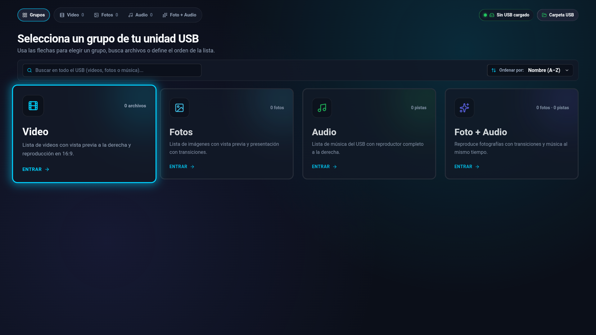
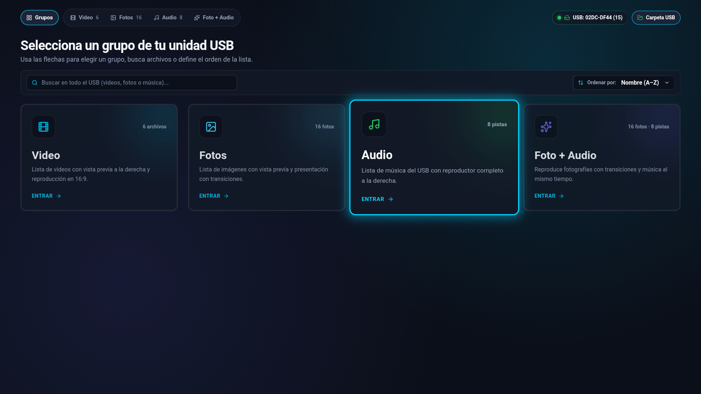
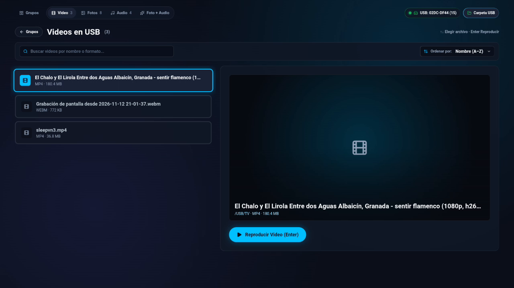

# Cinemateca Living Room

Visor de fotos, videos y audio almacenados en un USB conectado a un televisor Android TV. Se controla con el mando (D-pad) y se instala como una app más del launcher, dentro de un contenedor WebView nativo.



## Demo

Recorrido corto con el USB cargado: [docs/screenshots/demo-cinemateca.mp4](docs/screenshots/demo-cinemateca.mp4)

| Biblioteca con USB | Lista de videos |
|---|---|
|  |  |

## Funciones

- **Carpeta USB:** lee los discos montados en `/storage` y muestra su contenido. Los archivos se reproducen desde el propio USB; no se suben a ningún servidor.
- **Video:** lista con vista previa y reproductor con retroceder, adelantar, video anterior y video siguiente.
- **Fotos:** presentación con temporizador y selección de transición.
- **Audio:** reproductor persistente en la parte inferior de la pantalla.
- **Foto + Audio:** presentación de fotos con música de fondo.
- **Navegación por D-pad:** movimiento espacial entre elementos. El buscador solo entra en modo escritura al pulsar Enter. Atrás cierra el nivel actual.

## Compatibilidad con Android TV

| Versión | Estado |
|---|---|
| Android 9 (API 28) | Probado en un Android TV real (WebView Chromium 138) |
| Android 8.1 o anterior | No soportado: la app avisa al iniciar |
| Android 10 y superiores | Compatible por diseño, pero sin pruebas aún |

Requisitos mínimos del WebView: Chromium 80 o superior. Si no se cumple, la app muestra un aviso al iniciar.

En Android 9 la app pide `READ_EXTERNAL_STORAGE`. En Android 11 o superior usa «Acceso a todos los archivos» (`MANAGE_EXTERNAL_STORAGE`); esa rama no se ha probado en hardware.

## Estructura

```
src/
  App.tsx                 Navegación global y estado
  components/             Menú superior, grupos, listas y reproductores
  utils/usbMedia.ts       Lectura de archivos del USB
  utils/audioEngine.ts    Motor de audio
  data/usbSamples.ts      Vacío: la biblioteca empieza sin archivos
android/
  app/src/main/java/com/jonathan/cinemateca/MainActivity.kt   WebView, permisos y puente con el USB
  build-apk.sh            Compila la web y genera el APK
docs/screenshots/         Capturas y video de demostración
```

## Requisitos

- Node.js 22 o superior
- Para generar el APK: Android SDK con `ANDROID_HOME` configurado y Java 17 o superior
- Android TV con Android 9 (API 28) o superior

## Instalación

### Ejecutar en el navegador (desarrollo)

```bash
npm install
npm run dev
```

La app queda en `http://localhost:3000`. El navegador no tiene acceso al USB: la lectura de archivos solo funciona dentro de la app Android.

### Compilar el APK

```bash
npm install
./android/build-apk.sh
```

El script compila la web (`dist/`), copia el resultado a los assets de Android y genera `android/app/build/outputs/apk/debug/app-debug.apk`.

### Instalar en el TV

Activa la depuración por red en el TV y ejecuta:

```bash
adb connect <IP-del-TV>:5555
adb install -r android/app/build/outputs/apk/debug/app-debug.apk
```

Luego conecta el USB al TV, abre «Cinemateca Living Room» y pulsa **Carpeta USB**.

## Notas técnicas

- `vite.config.ts` usa `base: "./"` para que los recursos carguen dentro del WebView.
- `index.html` fija el viewport en 1920 px con zoom 0,5, porque el WebView del TV escala 2 px por píxel CSS.
- El paquete de la app es `com.jonathan.cinemateca`.

## Licencia

Pendiente de definir por el autor.
